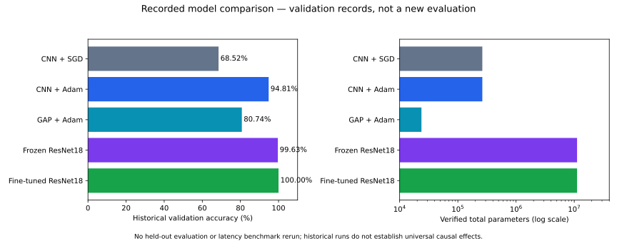

# Steel Surface Defect Classification

A PyTorch project exploring steel defect classification from data preparation and model comparison to a Streamlit inference application.

## 1. Project Overview

Surface defects affect steel quality. This project investigates how classifiers trained from scratch compare with transfer learning for identifying six NEU-CLS defect categories. The goals are to build a reproducible preprocessing and training pipeline, compare accuracy against model size, and package the selected models into an interactive application.

The experiments progress from a custom CNN with SGD/Adam, to a smaller global average pooling (GAP) CNN, then frozen and fine-tuned ResNet18. The selected fine-tuned ResNet18 achieved a **historical held-out accuracy of 99.26% (268/270)** and **macro-F1 of 0.9926**. These are saved research results, not a new evaluation performed during source preparation.

**This is a code-only repository.** Dataset images and trained checkpoints are excluded. Users must acquire authorized data and train their models, or obtain compatible weights they are authorized to use. Streamlit starts without weights and explains what is needed before predictions are available.

## 2. Dataset

The original NEU-CLS inventory contains **1,800 grayscale images**, each **200 × 200 pixels**, with 300 images per category. Obtain the classification dataset from the [NEU database page](https://faculty.neu.edu.cn/songkc/en/zdylm/263270/list/index.htm) and review the applicable terms. NEU-DET detection annotations are not interchangeable with this classification dataset.

The following class order is fixed for training, evaluation and inference:

| Index | Category / local folder | Visual characteristic |
|---|---|---|
| 0 | `crazing` | Networks of fine cracks |
| 1 | `inclusion` | Foreign material embedded in the surface |
| 2 | `patches` | Irregular surface patches |
| 3 | `pitted_surface` | Small surface pits |
| 4 | `rolled-in_scale` | Scale pressed into the steel surface |
| 5 | `scratches` | Linear surface marks |

Store images in those six folders under a local dataset root, such as `data/NEU-CLS/`. Dataset examples and misclassification image crops are not redistributed because image redistribution rights have not been confirmed. The comparison chart below contains aggregate results only.

## 3. Data Preprocessing

1. **Remove the exact duplicate:** retain `patches/Pa_101.bmp` and exclude `patches/Pa_105.bmp`, leaving **1,799 images**. Removing duplicate content reduces the risk of identical images appearing across splits.
2. **Create stratified splits:** sort by class and filename, split 70% for training, then divide the remaining 30% equally into validation and test sets, using seed **42**. Stratification preserves class proportions: **1,259 training / 270 validation / 270 test** images. Validation and test each have 45 images per class.
3. **Custom CNN/GAP inputs:** convert to grayscale, then `ToTensor`, producing **1 × 200 × 200** tensors in **[0, 1]**. This retains the original image resolution and single-channel baseline. These models do not resize or apply ImageNet normalization.
4. **ResNet18 inputs:** `Resize((224, 224)) → Grayscale(3) → ToTensor → Normalize`. Replicating grayscale into three channels matches ResNet18's input structure; ImageNet normalization aligns the input with its pretrained configuration. Mean: `(0.485, 0.456, 0.406)`; standard deviation: `(0.229, 0.224, 0.225)`.

The recovered split recipe is reproducible, but historical membership is only partially verified: 40 saved paths were corroborated; remaining memberships were inferred from the recipe. Matching counts alone does not prove an identical historical inventory. Duplicate screening also cannot establish independence of physical steel surfaces.

Implementation: [preprocessing](src/steel_defect/data/preprocessing.py), [dataset](src/steel_defect/data/dataset.py), and [splitting](src/steel_defect/data/splitting.py).

## 4. Model Architectures

| Model | Experimental purpose | Architecture / trainable layers | Total parameters |
|---|---|---|---:|
| Custom CNN | Establish a baseline from scratch; compare SGD and Adam | Three Conv/ReLU/MaxPool blocks, channels 1→16→32→64; flatten 64×25×25; 40,000→6 head; all layers trainable | 263,302 |
| GAP CNN | Investigate a smaller alternative to flattening | Same convolution blocks; adaptive average pooling to 1×1; 64→6 head; all layers trainable | 23,686 |
| Frozen ResNet18 | Evaluate pretrained feature extraction | ImageNet-initialized backbone with six-class head; only `fc` trainable (3,078 parameters) | 11,179,590 |
| Fine-tuned ResNet18 | Adapt higher-level pretrained features to steel defects | Starts from the trained frozen model; `layer4` and `fc` trainable (8,396,806 parameters) | 11,179,590 |

The baseline establishes what a compact model can learn from the dataset. GAP tests the parameter/performance trade-off of replacing spatial flattening. Transfer learning then tests whether pretrained features improve performance on this small dataset, followed by targeted adaptation of the final residual stage. BatchNorm statistics remain fixed in both ResNet training stages.

## 5. Training Pipeline

All experiments use **cross-entropy loss**, batch size **32**, and validation-loss checkpoint selection. Each epoch performs a training pass with gradient updates, followed by validation without gradient updates. Epoch loss is weighted by sample count. Early stopping uses patience **5**.

| Preset | Optimizer | Learning rate | Maximum epochs | Trainable layers |
|---|---|---|---:|---|
| `cnn_sgd` | SGD | 0.01 | 20 | All |
| `cnn_adam` | Adam | 0.001 | 20 | All |
| `gap_adam` | Adam | 0.001 | 20 | All |
| `resnet_frozen` | Adam | 0.001 | 20 | `fc` |
| `resnet_finetuned` | Adam | `layer4`: 0.00001; `fc`: 0.0001 | 15 | `layer4`, `fc` |

Fine-tuning uses a lower backbone learning rate to adapt pretrained features cautiously while allowing the classification head to update faster. Its initial frozen checkpoint is retained if no epoch improves validation loss.

Each new run saves `config.json`, `history.json`, `train.log` and `best.pth` under `results/runs/<run-id>/`. Existing run directories are rejected to prevent overwriting previous experiments. Configuration and training logic are in [default.json](configs/default.json), [train.py](scripts/train.py) and [trainer.py](src/steel_defect/training/trainer.py).

## 6. Evaluation & Results

Validation guided model development and checkpoint selection. The held-out test set provided the final assessment of the selected fine-tuned ResNet18; no held-out results are claimed for the other models.

### Historical validation comparison

| Experiment | Accuracy | Macro-F1 | Cross-entropy loss |
|---|---:|---:|---:|
| Custom CNN + SGD | 68.52% | 0.6830 | 0.9862 |
| Custom CNN + Adam | 94.81% | 0.9488 | 0.1520 |
| GAP CNN + Adam | 80.74% | 0.8024 | 0.5266 |
| Frozen ResNet18 | 99.63% | 0.9963 | 0.0283 |
| Fine-tuned ResNet18 | 100.00% | 1.0000 | approximately 0.0005 |



Adam performed better than SGD in the recorded shared-initialization CNN experiment. GAP reduced parameter count but had lower validation performance. Transfer learning produced the strongest recorded results; fine-tuning further reduced validation loss. These are observations from limited experiments, not universal causal conclusions: architectures, pretraining, learning rates and schedules differ, and multiple-seed distributions are unavailable.

### Selected model: historical held-out test

| Metric | Fine-tuned ResNet18 |
|---|---:|
| Accuracy | **99.26%** |
| Macro-F1 | **0.9926** |
| Cross-entropy loss | **0.0264** |
| Correct predictions | **268 / 270** |

The saved report records two errors: **scratches predicted as inclusion**. Original confusion-matrix images, misclassification examples and learning-curve figures remain outside this code-only release. No missing figures or outputs have been fabricated. New authorized evaluation runs export `metrics.json` and `confusion_matrix.png`; training runs save learning history for plotting.

These metrics were checked against saved notebook outputs. No retraining or held-out test evaluation was performed to prepare this repository. See [research summary](docs/RESEARCH_SUMMARY.md) for further historical context.

## 7. Streamlit Application

The interface supports PNG, JPG/JPEG and BMP uploads, a five-model selector, an image preview, the predicted defect class and all six softmax scores. Fine-tuned ResNet18 is the default; inference runs on CPU.

Inference flow:

1. Select a model and load its compatible local checkpoint.
2. Upload and decode an image; the app converts it to RGB.
3. Apply the selected architecture's preprocessing. CNN/GAP require 200×200 uploads; ResNet inputs are resized and normalized as described above.
4. Run inference to obtain six logits, apply softmax, and display the highest-scoring class plus all class scores.

Models are cached with `st.cache_resource`; model identity, checkpoint path and modification time are part of the cache key. Loading uses a strict state dict with `weights_only=True`. A missing or incompatible file gives a helpful message; the application does not substitute random weights or fabricated predictions. Softmax scores are not calibrated probabilities of correctness.

### Required local checkpoint files

Train your model, then copy the resulting `best.pth` into `models/` with the corresponding filename:

| Model selection | Expected local file |
|---|---|
| Fine-tuned ResNet18 (default) | `models/best_resnet18_finetuned.pth` |
| CNN + SGD | `models/best_sgd.pth` |
| CNN + Adam | `models/best_adam.pth` |
| GAP CNN + Adam | `models/best_gap.pth` |
| Frozen ResNet18 | `models/best_resnet18_frozen.pth` |

Only the selected model needs a checkpoint. Its architecture and class order must match this implementation. All weights are ignored by Git. `STEEL_DEFECT_CHECKPOINT` optionally overrides the fine-tuned ResNet18 path only. See [checkpoint setup](models/README.md).

## 8. Installation & Usage

Use Python **3.12 or newer** in a virtual environment and run commands from the repository root. Prior isolated installation verification targeted Python 3.14.5 on macOS arm64; other platform/version combinations are not claimed verified. CPU is the default.

```bash
# After cloning or downloading this repository:
python3 -m venv .venv
source .venv/bin/activate
python -m pip install -e '.[dev]'
python -m pytest -q
python -m streamlit run app.py
```

For UI/inference only, use `python -m pip install -e .`. `requirements.txt` pins runtime dependencies, `requirements-dev.txt` adds experiment/test tools, and `requirements-lock.txt` records the full previously verified dependency set. Optional exact dependency recreation:

```bash
python -m pip install -r requirements-lock.txt
python -m pip install --no-build-isolation --no-deps -e .
```

Using `python -m streamlit` from the activated environment avoids launching a global or Anaconda installation. The supported usage is an editable source checkout; a standalone wheel does not bundle external configuration, scripts or checkpoints.

### Prepare data and train

Acquire authorized NEU-CLS data first, then generate local split manifests:

```bash
python scripts/recover_splits.py --dataset-root data/NEU-CLS --output data/splits
python scripts/train.py --experiment cnn_adam --run-id cnn-adam-001 \
  --dataset-root data/NEU-CLS --splits data/splits
cp results/runs/cnn-adam-001/best.pth models/best_adam.pth
```

The recovery script expects the original filtered inventory of 1,799 images; it is not a generic splitter. It refuses to overwrite existing manifests.

For the default Streamlit model, train the frozen stage, copy its checkpoint, then fine-tune:

```bash
python scripts/train.py --experiment resnet_frozen --run-id frozen-001 \
  --dataset-root data/NEU-CLS --splits data/splits
cp results/runs/frozen-001/best.pth models/best_resnet18_frozen.pth
python scripts/train.py --experiment resnet_finetuned --run-id finetuned-001 \
  --dataset-root data/NEU-CLS --splits data/splits
cp results/runs/finetuned-001/best.pth models/best_resnet18_finetuned.pth
python -m streamlit run app.py
```

Frozen training may download torchvision's ImageNet initialization. Review upstream terms before use. Run these copy commands only when the destination is new or you intend to replace your own local deployment file; retain valuable checkpoints separately.

### Evaluate a local checkpoint

```bash
python scripts/evaluate.py --checkpoint models/best_adam.pth --model cnn \
  --split val --dataset-root data/NEU-CLS --splits data/splits \
  --output results/cnn-adam-validation-001
```

Architecture choices are `cnn`, `gap`, `resnet_frozen` and `resnet_finetuned`. Evaluation requires an explicit split and a new output directory. The example uses validation; installation and tests do not evaluate the held-out set. These commands describe how users can run their own experiments; they were not executed to generate this README.

## 9. Project Structure

```text
app.py                         Streamlit interface
inference.py                   Backward-compatible inference imports
configs/default.json           Experiment presets and hyperparameters
src/steel_defect/
  data/                        Dataset loading, preprocessing and splits
  models/                      CNN, GAP CNN and ResNet18 architectures
  training/                    Training loop, seeds and checkpoint handling
  evaluation/                  Metrics and confusion-matrix export
  deployment/                  Model registry, inference and benchmarking
  analysis/                    Optional duplicate/similarity audit helpers
scripts/                       Training, evaluation, split recovery and verification
tests/                         Unit and Streamlit tests
models/                        Setup documentation; add local .pth files here
data/splits/                   Setup documentation; generate local split CSVs
results/                       Generated run outputs, ignored by Git
docs/RESEARCH_SUMMARY.md       Historical results and limitations
docs/figures/                  Aggregate comparison chart
licenses/                      Retained upstream license texts
```

The original research notebook, datasets, trained checkpoints and private research outputs are not distributed. Tests use synthetic fixtures; optional original-checkpoint tests skip when the matching historical files are absent.

## 10. Reproducibility

Seed **42** is used for the split recipe, Python, NumPy and PyTorch. Training disables cuDNN benchmarking and requests deterministic cuDNN behavior. Batch size, learning rates, epoch limits, device and initial checkpoint are configured in [configs/default.json](configs/default.json); CLI overrides are available through `python scripts/train.py --help`.

Training records resolved configuration and epoch history. Checkpoint selection uses validation loss, not test performance. Exact historical reproduction is not guaranteed: full interactive notebook RNG consumption, complete original split identities and the original environment are unavailable. Different hardware and library versions can also change numerical results.

Additional tools:

```bash
# Regenerate aggregate historical comparison chart; does not evaluate models.
python scripts/plot_comparison.py

# Compare refactored final-ResNet inference against the original source reference.
python scripts/verify_deployment.py \
  --checkpoint models/best_resnet18_finetuned.pth \
  --image /path/to/authorized-non-test-image.bmp

# Measure local final-ResNet inference timing, without computing test accuracy.
python scripts/benchmark.py --checkpoint models/best_resnet18_finetuned.pth \
  --device cpu --warmup 20 --repetitions 100 --output results/benchmark-001.json
```

The chart script currently reads aggregate historical metadata from [CHECKPOINT_AUDIT.json](docs/CHECKPOINT_AUDIT.json). Parity checks compare transformed tensors and all six scores using the same supplied checkpoint and image. Synthetic tests check software behavior, not classification accuracy. Timing measurements must distinguish model-only inference from preprocessing and end-to-end browser latency.

## 11. Limitations & Future Work

- The test set has only 270 images; high NEU-CLS accuracy does not establish robustness across factories, cameras, lighting or surface textures.
- Recovered splits lack complete historical membership evidence and physical surface group identifiers, limiting claims about independence and generalization.
- Experiments do not provide multiple-seed uncertainty estimates or controlled external replication.
- There is no defect-free class, localization, unknown-class rejection or confidence calibration. The application is a research demonstration, not a validated industrial quality-control system.
- CPU is the application default; CUDA/MPS deployment and other platforms remain unverified for this release.

Future work includes authorized external and surface-group-aware evaluation, repeated-seed comparisons, calibration and rejection studies, learning-curve visualizations, additional model comparisons, and measured application latency and monitoring. These improvements are proposed, not completed.

## 12. Credits & Licensing

NEU-CLS is attributed to its dataset creators and the [original database page](https://faculty.neu.edu.cn/songkc/en/zdylm/263270/list/index.htm). ResNet18 uses torchvision's implementation and ImageNet initialization during frozen-stage training. PyTorch, torchvision, Streamlit and other dependencies retain their own licenses.

Original project code and software documentation are provided under the [MIT license](LICENSE). This grant excludes dataset images, model weights and third-party software; see [license scope](LICENSE_SCOPE.md), [third-party notices](THIRD_PARTY_NOTICES.md) and retained texts in `licenses/`.

Public availability does not establish redistribution permission. Dataset and trained-weight redistribution rights remain unresolved, so this repository distributes neither. Supplying or distributing a `.pth` file is model distribution and requires its own rights assessment; the code license does not grant those rights.
